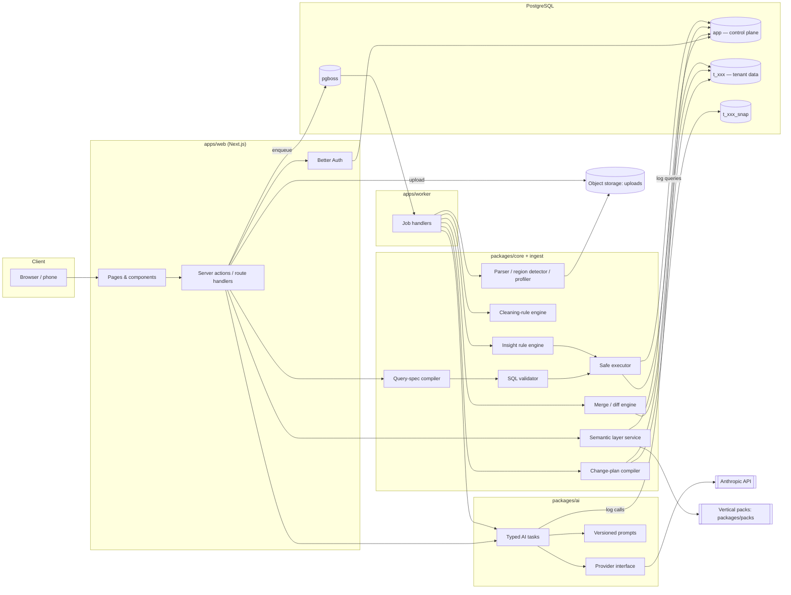
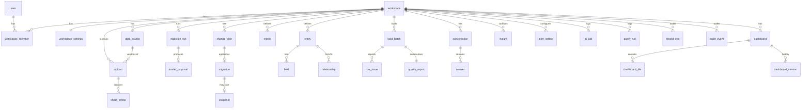

# Architecture

Status: **Draft v1 (planning)**. No code exists yet. This describes the target architecture for the MVP
(M0–M8). Decisions referenced as ADR-NNN are in `docs/DECISIONS.md`.

---

## 1. System overview

BizRetriever has five logical subsystems:

1. **Web app** (`apps/web`, Next.js). UI, auth, route handlers and server actions. It is stateless and
   serverless-friendly.
2. **Worker** (`apps/worker`, Node process). Long-running jobs: parsing, profiling, AI data modeling,
   loading, merging, insight generation, digests. It consumes the pg-boss queue.
3. **Core engine** (`packages/core`, `packages/ingest`). Deterministic, heavily tested logic:
   - change-plan compiler
   - query-spec compiler
   - SQL validator
   - safe executor
   - cleaning rules
   - merge/diff
4. **AI layer** (`packages/ai`). Provider abstraction, versioned prompts, typed AI tasks, cost logging. It
   never touches the database directly. Its outputs are inert data that the core engine validates.
5. **PostgreSQL**:
   - `app`: the control plane
   - `t_<id>`: one schema per workspace, holding that business's data
   - `t_<id>_snap`: snapshots for rollback
   - `pgboss`: the job queue

Plus file storage for uploads, behind a `Storage` interface:

- local filesystem in dev
- Postgres in the free hosted preview
- S3-compatible storage in paid production (ADR-013)



**Key boundaries:**

- **The AI layer only returns data:**
  - proposals
  - change plans
  - query specs
  - SQL text
  - narration templates

  `packages/core` validates every one of these. Writes need explicit user approval.
- **The control-plane connection (`bizr_app`) cannot read tenant schemas.** Tenant access goes through
  dedicated roles (section 6).
- **Packs are versioned files in the repo.** A workspace records which pack id and version it was created
  with.

---

## 2. Data flow: ingestion (Journey 1)

```mermaid
sequenceDiagram
  autonumber
  actor U as Owner
  participant W as Web
  participant S as Object storage
  participant Q as pg-boss
  participant K as Worker
  participant AI as AI layer
  participant DB as Postgres

  U->>W: Upload files
  W->>S: Store originals (immutable)
  W->>DB: app.uploads, app.ingestion_runs (status=queued)
  W->>Q: enqueue ingest.analyze(run_id)
  Q->>K: ingest.analyze
  K->>S: Read file
  K->>K: Parse sheets → raw grids (encoding detection, merged cells)
  K->>K: Region detection (header rows, section rows, totals, blanks, notes)
  K->>K: Column profiling (types, formats, nulls, distinct, near-duplicates)
  K->>DB: app.sheet_profiles (no raw rows beyond masked samples)
  K->>AI: proposeDataModel(pack, settings, masked profiles)
  AI-->>K: ModelProposal (typed JSON)
  K->>K: Validate proposal against pack + profiles
  K->>K: Dry-run cleaning + mapping on full data (in memory / temp)
  alt dry run shows severe problems
    K->>AI: reviseDataModel(proposal, dry-run errors)  (max 2 repair rounds)
  end
  K->>DB: app.model_proposals (proposal + dry-run stats), run status=awaiting_review
  W-->>U: "Here's what we found" (plain-language review)
  U->>W: Approve / correct (controls or chat → reviseDataModel)
  W->>Q: enqueue ingest.apply(proposal_id)
  Q->>K: ingest.apply
  K->>K: Compile ChangePlan → DDL (deterministic)
  K->>DB: Migration in transaction on t_xxx; record app.migrations
  K->>DB: Load cleaned rows in batches (COPY), lineage columns
  K->>DB: app.row_issues, app.quality_reports
  K->>DB: Populate semantic layer from pack (entities, fields, metrics availability)
  K->>DB: Generate default dashboard; run insight rules
  W-->>U: Data quality report → dashboard
```

Notes:

- **Original files are kept, unchanged.** Re-running ingestion is always possible.
- **The AI never sees full files.** It only gets profiles, plus up to 20 masked sample values per column and
  the first ~15 raw rows of each detected region (cells truncated to 80 characters).
- **The dry run makes the review screen honest.** Counts like "We found 412 products" and "14 rows look
  like totals" come from actually applying the proposed rules, not from the model.
- **Progress** is written to `app.ingestion_runs.progress` (stage + percent) and polled by the UI every
  1–2s. Server-sent events are a later optimisation.

---

## 3. Data flow: question answering (Journey 2)

```mermaid
sequenceDiagram
  autonumber
  actor U as Owner
  participant W as Web
  participant SEM as Semantic layer
  participant AI as AI layer
  participant C as Core (compiler/validator/executor)
  participant DB as Tenant schema

  U->>W: "Which products made me the most profit last month?"
  W->>SEM: Load catalog (entities, fields, metrics, synonyms, value lists)
  W->>AI: interpretQuestion(catalog, settings, history, question)
  AI-->>W: {kind: query_spec | clarify | sql_fallback | unanswerable, assumptions[]}
  alt clarify
    W-->>U: One short clarifying question (with options)
  else query_spec
    W->>C: validate spec → compile to SQL (deterministic)
  else sql_fallback
    W->>C: parse (libpg-query) → allowlist validation
  end
  C->>DB: BEGIN READ ONLY; SET LOCAL ROLE t_xxx_reader; SET LOCAL search_path; timeout; LIMIT
  DB-->>C: Result rows
  C->>C: Log app.query_runs
  W->>W: Chart selection (deterministic rules over result shape)
  W->>W: Fact extraction (totals, top/bottom, change vs comparison) → named values
  W->>AI: narrate(question, facts as placeholders, assumptions)
  AI-->>W: Template text with {{fact_id}} placeholders only
  W->>W: Verify (no stray digits, only known placeholders) → render with formatting
  W-->>U: Answer + chart + "How I calculated this" (+ SQL in Details)
```

"How I calculated this" is generated deterministically from the query spec: metric definitions from the
pack, filters, date range, and assumptions. For the SQL-fallback path, the explanation is AI-written from
the *validated* SQL and labelled as a custom calculation.

---

## 4. Control-plane data model (`app` schema)

Managed with Drizzle and `drizzle-kit` migrations. Better Auth's tables (`user`, `session`, `account`,
`verification`) also live in `app`.



| Table | Purpose / key columns |
|---|---|
| `workspace` | id, name, slug, `tenant_schema` (`t_<id>`), `pack_id`, `pack_version`, `is_demo`, created_by |
| `workspace_member` | workspace_id, user_id, role (`owner` \| `member`; more roles later), invited_by, status |
| `workspace_settings` | currency (ISO 4217), timezone (IANA), date_order (`DMY` \| `MDY` \| `YMD`), fiscal_year_start_month, week_start, pii_masking (bool) |
| `upload` | file name, size, mime, storage key, sha256, data_source_id, uploaded_by, status |
| `storage_blob` | content-addressed key (`w/<workspace>/<sha256>`), workspace_id, bytes (`bytea`). Only used by the Postgres storage driver in the free hosted preview (ADR-013) |
| `sheet_profile` | upload_id, sheet name, detected regions (JSON), column profiles (JSON), masked samples |
| `data_source` | logical recurring source ("Online orders file"), fingerprint (header signature, sheet names), target entity mappings, last upload |
| `job_run` | Generic background-job run (ADR-029): job name, input, checkpoint (`state`, `step_index`), status, progress {stage, pct}, error (user-safe + internal), timings. **Exists since M0.** |
| `ingestion_run` | type (`initial` \| `reupload`), `job_run_id`, data-source links, timings |
| `model_proposal` | run_id, version, origin (`ai` \| `heuristic`), base proposal, owner corrections, proposal (base + corrections), review JSON (dry-run counts, examples, skipped lines, warnings, summary), changes, status (`draft` \| `approved` \| `superseded`) (ADR-034) |
| `change_plan` | origin (`ingestion` \| `chat` \| `system`), plan JSON, impact JSON, status, confirmed_by/at |
| `migration` | per-workspace sequence `version`, change_plan_id, forward SQL (generated), inverse plan JSON, `lossy_rollback` flag, snapshot_id, applied_at, rolled_back_at |
| `snapshot` | migration_id, objects copied (tables in `t_xxx_snap`), row counts, expires_at |
| `entity` | workspace_id, canonical key (pack entity id or `custom:*`), physical table, display name (singular/plural), description, natural key fields |
| `field` | entity_id, canonical key, physical column, display name, data type, semantic type (money, quantity, date, email…), unit, format, synonyms[], is_pii, nullable, source lineage |
| `relationship` | from entity/field → to entity/field, cardinality, display phrase ("each sale belongs to a customer") |
| `metric` | workspace_id, pack metric id or custom, display name, definition (plain language), expression (typed metric IR, not SQL), required fields, default grain, format, `available` + `unavailable_reason` |
| `load_batch` | ingestion_run_id, entity_id, rows_in, rows_inserted, rows_updated, rows_skipped, rows_flagged |
| `row_issue` | load_batch_id, source sheet, source row number, reason code, plain-language reason, raw values (masked) |
| `quality_report` | run-level summary JSON (counts, assumptions, warnings) |
| `conversation` / `answer` | question text, interpretation JSON, query spec / SQL, result snapshot (capped), chart config, narrative template + rendered text, assumptions, feedback (👍/👎) |
| `dashboard` / `dashboard_tile` / `dashboard_version` | tile = query spec + chart config + layout {x,y,w,h} + title; versions for undo |
| `insight` | rule id, entity refs, severity, facts JSON, rendered text, status (`new` \| `seen` \| `dismissed` \| `resolved`), fingerprint for dedupe, generated_at |
| `alert_setting` | rule id, enabled, thresholds JSON |
| `ai_call` | task, prompt_version, model, latency_ms, input/output/cache-read/cache-write tokens, cost_usd (numeric), status, workspace_id, correlation id |
| `query_run` | origin (`ask` \| `dashboard` \| `insight` \| `system`), path (`spec` \| `sql_fallback`), sql hash + text, duration, row count, error, workspace_id |
| `record_edit` | entity, record id, operation, before/after JSON, origin (`grid` \| `chat`), user, undo pointer |
| `audit_event` | generic audit trail (auth events, approvals, confirmations, rollbacks) |

---

## 5. Tenant data model (`t_<id>` schemas)

- **One schema per workspace**, named `t_<10-char lowercase id>`.
- **Physical names** are deterministic snake_case, derived from canonical keys (`products`, `sales`,
  `sale_lines`). User-facing names live only in the semantic layer, so renames are metadata-only.
- **Every tenant table has system columns:**

  | Column | Purpose |
  |---|---|
  | `_id bigint generated always as identity primary key` | Row id |
  | `_natural_key text` | Normalised business key used for merging; nullable, indexed |
  | `_row_hash bytea` | Hash of business columns, used to detect changes |
  | `_source_upload_id uuid`, `_source_sheet text`, `_source_row int` | Lineage: "where did this record come from?" |
  | `_created_at`, `_updated_at timestamptz` | Timestamps |
  | `_deleted_at timestamptz` | Soft delete. User deletes are soft; the query compiler filters them |

- **Relationships** use `<entity>_id bigint references <table>(_id)`. The original text key is kept in a
  `<entity>_ref text` column, so unmatched references are never lost (e.g. a sale line whose SKU isn't in
  the product list).
- **Types:**
  - money: `numeric(18,4)`
  - quantities: `numeric(18,4)`
  - dates: `date` / `timestamptz` (normalised to workspace timezone)
  - text: `text`
  - booleans: `boolean`
  - enumerations: `text` (allowed values in `field` metadata, not Postgres enums)
- **Indexes:** on `_natural_key`, on relationship columns, and on date columns used as the default time
  dimension.
- **Generated views (owned by the system):** for example `v_sale_lines_enriched`, which joins line to sale
  to product to customer. These simplify the SQL-fallback path and keep compiled queries short.

---

## 6. Tenant isolation model

Decision: schema-per-tenant plus per-tenant roles (ADR-004, ADR-005).

**Database roles:**

| Role | Login | Privileges |
|---|---|---|
| `bizr_app` | yes | Read/write on `app` and `pgboss` only. **No** privileges on any `t_*` schema. Used by the web app and worker for control-plane work. |
| `bizr_admin` | yes | Owns all `t_*` and `t_*_snap` schemas. Used *only* by the change-plan applier, loader, merge engine and provisioning code in the worker. Never executes AI-authored SQL. |
| `bizr_tenant` | yes | Has no direct privileges. It is a member (NOINHERIT) of every `t_<id>_reader` / `t_<id>_writer`, so it has to `SET ROLE` explicitly. Used only by the safe executor. |
| `t_<id>_reader` | no | `USAGE` on `t_<id>`, `SELECT` on its tables/views. Nothing else. |
| `t_<id>_writer` | no | Reader privileges plus `INSERT`/`UPDATE` on business tables (used for confirmed record edits). No DDL, no `DELETE` (soft delete only). |

**Every tenant query through the safe executor** (`executeTenantQuery`, `@bizr/core/executor`):

```sql
BEGIN READ ONLY;                                  -- (writer path: BEGIN; no READ ONLY)
-- settings first, as the broker role: tenant roles cannot call set_config at all
SELECT set_config('search_path', '"t_abc123"', true),        -- only the tenant schema
       set_config('statement_timeout', '8000', true),
       set_config('idle_in_transaction_session_timeout', '10000', true);
SET LOCAL ROLE t_abc123_reader;
DECLARE bizr_q NO SCROLL CURSOR FOR <validated or compiled SQL>;   -- values as bound parameters
FETCH FORWARD 5001 FROM bizr_q;                   -- 5001 to detect truncation
COMMIT;
```

`EXECUTE` on `pg_catalog.set_config` is revoked from PUBLIC (granted only to our login roles), so SQL
running as a tenant role cannot switch to another role or undo the timeout (ADR-005 amendment).

**Layers of defence for AI-originated SQL:**

1. **Primary path never runs model SQL.** The model emits a query spec and our compiler emits the SQL.
2. **Fallback SQL is parsed with `libpg-query`** (the real Postgres parser). Rejected if it:
   - is not exactly one `SelectStmt`
   - contains any utility/DML/DDL node, `FOR UPDATE`/`FOR SHARE`, `INTO`, or a writable CTE
   - references a schema-qualified relation outside `t_<id>`, `pg_catalog.*`, `information_schema.*`, or
     any relation not in the tenant allowlist
   - calls any function not in the allowlist (aggregates, date/math/string functions). This rejects
     `set_config`, `pg_sleep`, `dblink`, `lo_*`, `pg_read_file`, `current_setting` and similar.
   - exceeds the AST depth/size limits
3. **Role scoping.** Even if validation had a bug, the statement runs as `t_<id>_reader`, which has no
   privileges outside its schema. `READ ONLY` blocks writes.
4. **Resource limits:** statement timeout, row cap, and a result-size cap in bytes.
5. **Audit.** Every execution is logged to `app.query_runs` with the workspace id and SQL hash.

**Known residual risk.** `bizr_tenant` is a member of every tenant role. A validator bypass that let SQL
change role (e.g. `set_config('role', …)`) could cross tenants. This is mitigated by the function allowlist
(1) and by the fact that utility statements are rejected at the parse level. Planned hardening (post-MVP,
ADR-005): per-tenant login roles with short-lived credentials, so a connection can only ever assume one
tenant. The SQL validator gets a dedicated adversarial test suite in M4.

**Scaling note.** Schema-per-tenant is comfortable up to a few thousand workspaces per database. Beyond
that, shard workspaces across databases (the `workspace` row records its database), or move to
shared-table + RLS. See ADR-004.

---

## 7. Semantic layer

The semantic layer is the product's heart. It is stored in `app.entity`, `app.field`, `app.relationship`
and `app.metric`, seeded from the Vertical Pack and adjusted per workspace.

- **Entities and fields** carry display names, synonyms (pack synonyms plus the user's own column headers),
  semantic types, and PII flags.
- **Relationships** form a join graph. The query-spec compiler finds join paths with a shortest-path search
  over this graph. Ambiguous paths (two routes between the same entities) are resolved by pack-declared
  preferred paths, or else rejected.
- **Metrics** are defined in a small typed **metric IR**, never as SQL strings. Example:
  `{ agg: "sum", expr: { mul: [field("sale_line.quantity"), field("sale_line.unit_price")] }, filters: [...] }`.
  Derived metrics reference other metrics, e.g. `gross_margin_pct = gross_profit / net_sales`.
  - The compiler handles grain (fan-out-safe aggregation).
  - It handles time bucketing in the workspace timezone.
  - It handles comparison periods.
- **Metric availability is computed.** A pack metric whose required fields don't exist in this workspace is
  stored with `available=false` and a plain-language reason (e.g. "Add product costs to see profit"). The
  UI turns this into a call to action instead of an error.
- **The business glossary** ("What we track", M3) is a read-mostly UI over this catalog.

---

## 8. Change-plan engine (structural changes)

- **ChangePlan** is a Zod-validated list of operations:
  - `create_entity`
  - `add_field`
  - `rename_field_display` (metadata only)
  - `change_field_type`
  - `add_relationship`
  - `remove_relationship`
  - `remove_field`
  - `remove_entity`
  - `add_allowed_values`
  - `create_index`
  - `add_metric` / `update_metric` (semantic only)

  Full schema in `docs/AI_DESIGN.md`.
- **The compiler** (`packages/core/change-plan`) is pure: `(currentCatalog, plan) → { ddl[], catalogDelta,
  inversePlan, destructive: boolean, lossyRollback: boolean, impact }`.
- **Impact analysis** runs before confirmation:
  - rows affected and values that would fail type conversion (via a dry-run `SELECT` count)
  - dependent metrics, dashboard tiles and insight rules
- **Apply:**
  1. Snapshot, if destructive.
  2. Run the DDL and catalog update in **one transaction** as `bizr_admin`.
  3. Record `app.migration` with the next version number.
- **Rollback:**
  - Non-lossy rollback applies the stored inverse plan.
  - Lossy rollback (e.g. undoing `add_field` after users filled it in, or undoing `remove_field`) restores
    from snapshot. The user is told exactly what data entered after the change would be affected and has
    to confirm.

---

## 9. Merge engine (re-upload, Journey 4)

- **Matching the file to its source.** A re-uploaded file is matched to a `data_source` by fingerprint:
  normalised header signature, sheet names, and file-name similarity. The user confirms the match ("Is
  this an updated version of *Online orders*?").
- **Row identity**, in priority order:
  1. Pack-declared natural key (e.g. SKU for products, order number + line position for sale lines)
  2. User-confirmed key column
  3. `_row_hash` of business columns, as a last resort. In this case changes look like delete + add, so
     these rows are surfaced for review rather than auto-applied.
- **Diff classes:**
  - new
  - changed (field-level diff)
  - unchanged
  - missing from new file (**never deleted automatically**; listed for the user to decide)
  - conflicting (the record was edited in-app since the last upload; the user picks which to keep)
- **Apply.** The merge runs in one transaction as `bizr_admin`. Every changed record writes a
  `record_edit` row (origin `reupload`), so the whole merge can be undone.

---

## 10. AI pipeline design (summary)

Full detail is in `docs/AI_DESIGN.md`.

- **`packages/ai` exposes typed task functions,** e.g.:
  - `proposeDataModel`
  - `reviseDataModel`
  - `interpretQuestion`
  - `narrate`
  - `planChange`
  - `planDashboardEdit`
  - `planRecordWrite`
  - `phraseInsights`
  - `explainSql`

  Each has a Zod input/output schema, a prompt version, a model tier, and an eval set.
- **The provider interface** (`LLMProvider.generateStructured({ tier, system, messages, schema, ... })`)
  hides the Anthropic SDK. The Anthropic implementation:
  - uses structured outputs (`output_config.format` via `messages.parse` + `zodOutputFormat`)
  - uses adaptive thinking with per-task effort
  - uses prompt caching on the stable prefix (system prompt + pack + catalog)
  - handles `stop_reason` (`refusal`, `max_tokens`)
  - uses server-side refusal fallbacks
- **Model tiers come from env:**
  - `AI_MODEL_STRONG` (default `claude-opus-5-5`)
  - `AI_MODEL_STANDARD` (default `claude-sonnet-5-5`)
  - `AI_MODEL_FAST` (default `claude-haiku-5-5`)
- **Every call** writes an `app.ai_call` row, with cost computed from a price table in config.
- **Before every call,** a spend guard checks the configured budgets (`AI_BUDGET_DAILY_USD`,
  `AI_BUDGET_MONTHLY_USD`) against `app.ai_call` totals. Over budget → the call is refused with a friendly
  message, and deterministic fallbacks are used where they exist (ADR-027).
- **Demo replay mode.** With `AI_REPLAY_MODE=record|replay|off`, demo workspaces can serve recorded
  responses keyed by (task, prompt version, input hash). A flaky network can't break the investor demo
  (ADR-021).

---

## 11. Background jobs

pg-boss runs in the same Postgres instance (schema `pgboss`). It needs no extra infrastructure.

**Two runner modes, chosen by config (ADR-011, ADR-026):**

| Mode | `JOB_RUNNER` | Used in | How jobs run |
|---|---|---|---|
| Worker | `worker` | Local dev; paid production | `apps/worker` is a long-running process that subscribes to the queues |
| Inline (serverless drain) | `inline` | Free hosted preview (no worker server) | An authenticated route handler, `POST /api/jobs/drain`, fetches due jobs and runs **steps** within a time budget (`JOB_STEP_BUDGET_MS`, default 45s), then returns |

**What triggers a drain in inline mode:**

- the progress-polling UI, while a user is waiting on an import/merge/change
- `after()` at the end of the request that enqueued the job
- a daily platform cron, for `insights.run` (catch-up), `digest.weekly` and `snapshot.gc`

**Consequence: every job is a sequence of resumable, checkpointed steps.** Examples: parse sheet *n*;
profile; AI proposal; dry run; load entity *k* in batches of 5,000 rows. Each step:

- is idempotent
- records its checkpoint on the run row
- fits within the step budget

The worker simply runs steps back to back. The same handler code is used in both modes.

| Queue | Trigger | Notes |
|---|---|---|
| `ingest.analyze` | upload complete | parse → regions → profiles → proposal (rules, then AI if needed, ADR-033) → dry run |
| `ingest.revise` | user correction | AI revision + new dry run |
| `ingest.apply` | user approval | change plan → load → quality report → semantic layer → dashboard → insights |
| `merge.diff` / `merge.apply` | re-upload / approval | diff preview, then merge |
| `change.apply` / `change.rollback` | user confirmation | structural changes |
| `insights.run` | after any data change; daily cron | insight rules per workspace |
| `digest.weekly` | weekly cron (workspace timezone) | in-app digest |
| `snapshot.gc` | daily cron | expire old snapshots (default retention 30 days) |

**Rules for every job:**

- Jobs are idempotent: they key on run id and check status before acting.
- Each job reports progress to the corresponding `app.*_run` row.
- Each job writes user-safe error messages.

**Concurrency:** one structural/merge job per workspace at a time (pg-boss singleton key = workspace id).

---

## 12. Web app structure

- **Routes:**
  - `/` (marketing/landing)
  - `/sign-in`, `/sign-up`
  - `/onboarding`
  - `/w/[slug]/home`
  - `/w/[slug]/ask`
  - `/w/[slug]/dashboard`
  - `/w/[slug]/data` (records browser)
  - `/w/[slug]/data/sources` (uploads and updates)
  - `/w/[slug]/glossary`
  - `/w/[slug]/history` (change history)
  - `/w/[slug]/settings`
- **Every server action** resolves the workspace from the session plus membership. Workspace id never comes
  from client input alone.
- **Server-side rendering for reads; server actions for mutations.** Long operations return a run id and
  the client polls.
- **Mobile-first** for Home, Ask, Dashboard and Insights. Onboarding review is optimised for desktop but
  usable on mobile.

---

## 13. Deployment stages (ADR-016, ADR-026)

**Zero-cost rule:** we spend nothing on infrastructure until the product is in production and earning
revenue. The code is built so that moving between stages is configuration only.

| Component | Stage 0 — Local (default, $0) | Stage 1 — Free hosted preview (optional, $0) | Stage 2 — Paid production (after revenue) |
|---|---|---|---|
| Web | `pnpm dev` / `pnpm start` | Vercel Hobby (or Cloudflare/Netlify free; see OPEN_QUESTIONS Q19) | Vercel Pro (or equivalent) |
| Jobs | `apps/worker` (`JOB_RUNNER=worker`) | Inline drain (`JOB_RUNNER=inline`) + daily free cron | Dedicated worker (Railway/Fly/Render) |
| Postgres | Docker Compose (Postgres 17) | Neon Free (pooled URL for web; direct URL for admin steps) | Neon paid (or similar) |
| File storage | local `./.data/uploads` | Postgres driver (`app.storage_blob`, small files only) | Cloudflare R2 / S3 |
| Email | console (links printed in logs) | Resend free tier, or console + manual | Resend paid as volume needs |
| Error tracking | pino logs | pino logs (Sentry free tier optional) | Sentry |
| Domain | `localhost` | free platform subdomain | custom domain |
| Secrets | `.env.local` | platform env vars | platform env vars |

**The investor demo runs from Stage 0 (a laptop)** by default, with AI replay as a safety net (ADR-021).
Stage 1 is only for sharing a link, and its free-tier limits (storage, compute hours, function duration,
cron frequency, terms of use) must be re-checked when it's set up. Free tiers change often.

**CI:** GitHub Actions runs lint, typecheck, unit tests, and integration tests against a Postgres service
container. Free minutes apply: unlimited for public repos, a monthly allowance for private ones. CI
cancels superseded runs and caches pnpm to stay within that allowance. The AI eval suite never runs in CI
(ADR-027).

---

## 14. Observability

- **Structured logs:** pino with a correlation id per request/job.
- **`app.ai_call` and `app.query_runs`** are queryable for per-workspace cost and latency. An internal
  admin page (M8) shows AI cost per workspace, p50/p95 latencies, and validation-failure rates.
- **Error tracking:** structured logs only during the zero-cost phase. Sentry when in paid production
  (its free tier is optional earlier).
- **AI spend guard:** a hard daily/monthly budget check before every AI call (ADR-027).
