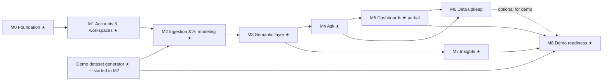

# Master Plan

**Legend:**

- `[ ]` todo, `[x]` done
- **★** marks the **demo-critical path**, the minimum needed for the investor demo
- Items marked **(cuttable)** can move after the demo if time is short

**Rules:**

- **Zero-cost rule (ADR-026):** free options only until production and revenue. The one exception is
  capped AI API spend (ADR-027). Anything that would cost money is raised with the owner first.
- Work milestone by milestone.
- A milestone is done only when its acceptance criteria pass **and** the owner confirms.
- Update the checkboxes at the end of every session.

## Milestone overview and dependencies

**Demo-critical path:** M0 → M1 → M2 → M3 → M4 → M5 (auto-dashboard, date filter, pin, chat edit) → M7
→ M8.

**Cuttable for a first demo if the date is tight:**

- M5 drag/resize layout
- M6 chat-based record entry
- M6 structural changes by chat (Journey 6)

Re-upload/merge (M6) is *not* cuttable for the product, but is optional for the first demo.

---

## M0 — Foundation ★

**Goal:** a runnable, well-tooled empty monorepo, with CI, local Postgres, and all planning docs.

**Docs:**

- [x] Planning docs created:
  - CLAUDE.md
  - PLAN
  - PROGRESS
  - ARCHITECTURE
  - DECISIONS
  - PRODUCT_SPEC
  - AI_DESIGN
  - VERTICAL_PACKS
  - DEMO_SCRIPT
  - OPEN_QUESTIONS
- [x] Owner approval of the plan; all proposed defaults accepted, plus the zero-cost rule (2026-10-13)

**Repo and tooling:**

- [x] pnpm workspace with these packages:
  - `apps/web`
  - `apps/worker`
  - `packages/{platform,db,core,ingest,ai,packs}` (`platform` added for env and logging)
  - `evals/`
  - `scripts/`
- [x] TypeScript strict base config, shared tsconfig (TypeScript 6.0; see ADR-028)
- [x] ESLint 10 (type-aware typescript-eslint, Next plugin, `no-restricted-imports` enforcing package
  boundaries). Import-order linting is deferred: not worth a plugin yet.
- [x] Prettier
- [x] Node 24 LTS pinned (`.nvmrc`; `engines` ≥ 22.12); pnpm pinned via `packageManager`
- [x] Next.js 16 app scaffold (App Router), Tailwind 4, shadcn/ui (components.json, tokens, Button), base
  layout, `/api/health`
- [x] Worker scaffold with pg-boss and graceful shutdown; `system.noop` job; `enqueue:noop` helper
- [x] Job framework (`@bizr/core/jobs`):
  - resumable, checkpointed steps (`app.job_run`, ADR-029)
  - `JOB_RUNNER=worker|inline`
  - `GET|POST /api/jobs/drain` (bearer secret, step time budget, `?maintenance=1`)
  - integration tests run the multi-step noop job in both modes, including yielding, resuming and
    failure
- [x] `docker-compose.yml`: Postgres 17 plus a test database. Roles are created by an idempotent
  `pnpm db:setup` (same command in CI) instead of an init script, so passwords come from `.env`.
- [x] Env config module with Zod validation (`getEnv()`); `.env.example` lists every variable
- [x] Drizzle setup in `packages/db`: migration tooling; initial migration creates `app` and `app.job_run`;
  migrate script grants control-plane privileges
- [x] Vitest across packages (unit + `*.int.test.ts` integration); Playwright smoke tests (desktop +
  mobile)
- [x] GitHub Actions CI (cancels superseded runs, caches pnpm, never calls the AI API):
  - install
  - format check
  - lint
  - typecheck
  - pack validation
  - unit + integration tests against a Postgres 17 service container
  - e2e smoke job
- [x] `pnpm` scripts as listed in CLAUDE.md (the ones that exist so far)
- [x] README with quick start
- [x] Logging: pino with correlation ids via AsyncLocalStorage (`withLogContext`)
- [ ] CI green on GitHub (first run pending)

**Acceptance:**

- `docker compose up -d && pnpm install && pnpm db:setup && pnpm db:migrate && pnpm dev` serves a page.
- `pnpm dev:worker` connects to the queue.
- CI is green on a PR to `main`.
- A fresh clone can follow the README with no undocumented steps.

---

## M1 — Accounts and workspaces ★

**Goal:** users can sign up, create a workspace with industry and locale settings, and get an isolated
tenant schema.

**Depends on:** M0.

- [ ] Better Auth: email/password + Google OAuth; sessions; password reset. Email goes to the console
  locally; an `EmailSender` interface gets a Resend (free tier) driver for hosted stages.
- [ ] Control-plane tables:
  - `workspace`
  - `workspace_member`
  - `workspace_settings`
  - `audit_event`
- [ ] Onboarding screen: business name, industry picker (retail pack), currency, date order (live
  example), timezone
- [ ] Tenant provisioning service (`packages/db/tenant`), run as `bizr_admin`:
  - create schema `t_<id>` and `t_<id>_snap`
  - create the roles `t_<id>_reader` and `t_<id>_writer`
  - set up grants
  - grant role membership to `bizr_tenant`
- [ ] Tenant deprovisioning (workspace delete) with typed confirmation
- [ ] Safe executor skeleton (`packages/core/executor`): transaction + `SET LOCAL ROLE` + `search_path` +
  timeout + row cap + `query_runs` logging
- [ ] **Isolation integration tests:**
  - tenant A's reader cannot read B's tables (even schema-qualified)
  - `bizr_app` cannot read any tenant
  - the reader cannot write
  - the writer cannot DDL
- [ ] App shell:
  - sidebar (desktop) and bottom tabs (mobile)
  - placeholder pages for Home / Ask / Dashboard / My data / More
  - workspace resolution from session + membership in every server action
- [ ] Members model (invite UI deferred; data model and owner/member roles in place)
- [ ] Pack loader (`packages/packs`): Zod schema for the pack format; `retail` pack skeleton (manifest +
  entities); `pnpm packs:validate`

**Acceptance:**

- A new user can sign up (email or Google), create a workspace, and see the app shell on desktop and
  mobile.
- A tenant schema and roles exist for the workspace.
- The isolation test suite passes in CI.
- No tenant access path exists through `bizr_app`.

---

## M2 — Ingestion and AI data modeling ★

**Goal:** messy files → AI proposal → plain-language review → approved → clean tenant tables + data quality
report.

**Depends on:** M1. The demo dataset generator starts here because it doubles as the main fixture.

**Demo data:**

- [ ] ★ `scripts/demo-data`: a seeded generator for the **Fernwood Home & Gift** dataset (see
  DEMO_SCRIPT §3). Has a `--today` anchor so stories are always current. Outputs messy xlsx/csv plus a
  clean ground-truth JSON.

**Parsing and profiling:**

- [ ] Storage interface with `local`, `postgres` (`app.upload_blob`) and `s3` drivers (the s3 driver is
  tested against MinIO in Docker; no cloud account needed); upload route with size/type checks; sha256
- [ ] Parsing: SheetJS (xlsx/xls), Papa Parse (csv), encoding detection; merged-cell expansion; Excel
  serial dates
- [ ] Region detector: header rows, multi-row headers, title rows, section rows, totals, blank and note rows,
  multiple tables per sheet. Unit-tested on fixtures.
- [ ] Column profiler: type candidates with ratios, date-format candidates with date-order resolution,
  number locale detection, units, currency symbols, null sentinels, distinct/top values, pattern
  signatures, near-duplicate clusters
- [ ] PII masking of samples (ADR-020)

**Cleaning and AI:**

- [ ] Cleaning-rule engine (`packages/ingest/cleaning`), covering all rules in AI_DESIGN §3.3, **test-first**
- [ ] Retail pack: full `entities.yaml`, `synonyms.yaml`, `patterns.yaml` (incl. known export formats),
  domain primer
- [ ] AI layer:
  - provider interface
  - Anthropic implementation (structured outputs, caching, refusal handling)
  - `ai_call` logging with cost
  - prompt versioning
  - replay mode (record/replay); tests and CI replay only, with a miss treated as a failure
  - spend guard (`AI_BUDGET_DAILY_USD` / `AI_BUDGET_MONTHLY_USD`) with deterministic fallbacks (ADR-027)
  - Sonnet-vs-Opus comparison for data modeling on the ingest eval, to pick the cheapest tier that meets
    the bar
- [ ] Task A `proposeDataModel`, Task B `reviseDataModel`, Task C `summarizeProposal`
- [ ] Proposal validator + dry-run executor (stats per entity, issues per row)

**Change plans and loading:**

- [ ] ★ Change-plan schema + compiler (create_entity, add_field, add_relationship, create_index),
  **test-first**, with golden DDL snapshots
- [ ] Migration recorder (`app.migration`) + catalog writer (`app.entity/field/relationship`)
- [ ] Loader:
  - batch COPY into tenant tables
  - lineage and system columns
  - natural keys and row hashes
  - reference resolution with an `<entity>_ref` fallback
  - `row_issue` + `quality_report`

**Jobs and UI:**

- [ ] Jobs: `ingest.parse`, `ingest.revise`, `ingest.apply`, written as checkpointed steps (each within
  `JOB_STEP_BUDGET_MS`), with progress reporting and idempotency; verified in both runner modes
- [ ] UI:
  - upload screen
  - processing screen (stages + teaser)
  - **"Here's what we found" review screen** (summary, questions, record-type cards, mapping edit menu,
    skip list, assumptions, correction chat)
  - setting-up screen
  - data quality report

**Evals:**

- [ ] Eval harness skeleton + `evals/fixtures/ingest` (≥ 10 cases at M2, ≥ 15 by M8) + injection canaries

**Acceptance:**

- The demo dataset goes from upload to loaded data with a correct quality report. Every entity count
  matches the generator's ground truth.
- ≤ 3 user questions. ≤ 2 minutes of user time.
- Ingest eval:
  - ≥ 90% field mapping F1
  - ≥ 95% totals/blank row detection
  - 0 injection canary failures
- Cleaning-rule and compiler unit tests ≥ 90% line coverage.
- Re-running `ingest.apply` is idempotent.

---

## M3 — Semantic layer ★

**Goal:** each workspace has a complete business catalog: entities, fields, relationships and metrics
(with availability), viewable in plain language.

**Depends on:** M2.

- [ ] Metric IR schema + compiler (aggregation, safe divide, filters, refs, time bucketing in the workspace
  timezone, comparison periods, fan-out-safe aggregation across joins)
- [ ] Join-path resolver over the relationship graph (preferred paths from the pack; ambiguity → error)
- [ ] Retail pack `metrics.yaml` (all metrics in VERTICAL_PACKS §2.5), with pack-level compile tests
- [ ] Metric availability computation + plain-language unavailable reasons + "unlock" hints
- [ ] System views per workspace (e.g. `v_sale_lines_enriched`), regenerated after structural changes
- [ ] Query-spec schema + compiler (`QuerySpec` → SQL), **test-first**, with golden SQL snapshots and
  result tests against the demo dataset
- [ ] "What we track" glossary page: measures with definitions, record types and their details, links
  ("Sales are linked to customers")
- [ ] Rename display names (metadata only) from the glossary

**Acceptance:**

- Every retail metric compiles and returns values on the demo dataset that match hand-computed ground
  truth, across:
  - date ranges
  - channel and category breakdowns
  - comparison periods
- Unavailable metrics show the correct reason when costs or stock are removed from the fixture.

---

## M4 — Ask ★

**Goal:** plain-language questions → correct, explained answers with charts. Safe by construction.

**Depends on:** M3.

- [ ] Task D `interpretQuestion` (spec / clarify / sql / unanswerable), with the ambiguity policy
- [ ] SQL validator (`libpg-query`) per AI_DESIGN §6, **test-first**, plus an adversarial suite of
  ≥ 150 cases
- [ ] Fact extraction (deterministic) + Task E `narrateAnswer` with placeholder validation + template
  fallback
- [ ] Task F `explainSql` (fallback path only)
- [ ] Deterministic chart chooser + Recharts components (kpi, line, bar, bar_horizontal, stacked_bar,
  table); accessible table alternative
- [ ] "How I calculated this" generator (deterministic from spec) + Details (SQL, records scanned)
- [ ] Ask UI: empty state with chips, thinking state, answer card, clarify card, unanswerable card,
  follow-ups (conversation context), 👍/👎 feedback
- [ ] Pin to dashboard (needs the M5 tile model; implement the tile storage here if M5 hasn't started)
- [ ] Question eval set (≥ 150 cases) + demo-script subset

**Acceptance:**

- Question eval:
  - ≥ 85% execution accuracy overall
  - ≥ 95% on the demo-script subset
  - clarification precision ≥ 80%
- SQL validator adversarial suite: 100% rejected or harmless.
- 0 narrative numbers not sourced from facts.
- Ask p95 latency ≤ 6s on the demo dataset.

---

## M5 — Dashboards ★ (partial ★)

**Goal:** an auto-generated industry dashboard on day one, editable by chat and by hand, with a global
date filter.

**Depends on:** M4 (shares spec compiler, charts, pin).

- [ ] ★ Dashboard/tile/version tables; tile = spec + chart + layout
- [ ] ★ Default dashboard generation from pack `dashboard.yaml`, skipping unavailable tiles + "Unlock more"
  card
- [ ] ★ Dashboard page with responsive grid (react-grid-layout), tile states, per-tile caching keyed by
  data version
- [ ] ★ Global date range picker + compare toggle; fixed-date tile badge
- [ ] ★ Task G `planDashboardEdit` + preview/apply/undo
- [ ] Drag/resize layout editing (desktop); reorder on mobile **(cuttable)**
- [ ] Tile ⋮ menu: rename, change chart, remove, "Ask about this"
- [ ] Dashboard edit eval set (≥ 40 cases)

**Acceptance:**

- A new demo workspace lands on a correct dashboard.
- "Add a chart of sales by city" / "remove X" / "show monthly" work via chat with preview and undo.
- The date filter updates all tiles.
- Dashboard edit eval ≥ 90%.

---

## M6 — Data upkeep

**Goal:** keep data current safely: re-upload with merge preview, a records browser with edits, adding
records by chat, structural changes by chat with versioning and rollback.

**Depends on:** M4, M5.

**Re-upload:**

- [ ] Data-source fingerprinting + match confirmation
- [ ] Merge/diff engine (`packages/core/merge`), **test-first**:
  - new / changed / unchanged / missing / conflicts
  - never auto-delete
  - `record_edit` for undo
- [ ] Re-upload UI: change preview, conflict resolution, apply, undo

**Records:**

- [ ] Records browser: virtualised grid (TanStack Table), filters, sort, search, inline type-aware edit,
  record side panel with lineage and history, soft delete + "Recently deleted"
- [ ] Mobile card list for records
- [ ] Task H `planRecordWrite` + confirmation card + writer-role execution + undo **(cuttable for the
  first demo)**

**Structural changes:**

- [ ] Change-plan compiler: remaining ops (change_field_type, remove_field, remove_entity,
  remove_relationship, add_allowed_values, metrics); impact analysis; inverse plans; lossy-rollback
  detection
- [ ] Snapshots (ADR-023) + `snapshot.gc` job
- [ ] Task I `planChange` + change plan card + typed confirmation for destructive changes **(cuttable for
  the first demo)**
- [ ] Change history page with undo

**Members:**

- [ ] Member invites (email link), member role enforcement

**Evals:**

- [ ] Eval sets: record writes (≥ 40), change plans (≥ 30)

**Acceptance:**

- Re-uploading the demo "next month" file shows the correct diff, merges without data loss, and can be
  undone.
- No code path deletes rows that are missing from a new file.
- Every structural change is versioned and rollback works, verified by an integration test for each op.
- Destructive changes always snapshot first.

---

## M7 — Insights ★

**Goal:** proactive, correct, plain-language insights after every data change, plus a weekly digest.

**Depends on:** M3. It can run in parallel with M4–M5 once M3 is done.

- [ ] Insight rule engine: compile pack rules (spec or trusted templates with placeholders), execute,
  facts, severity, fingerprint/cooldown/dismissal
- [ ] Retail pack `insights.yaml`: all rules in VERTICAL_PACKS §2.7, with thresholds
- [ ] Task J `phraseInsights` (optional phrasing) with placeholder validation
- [ ] Triggers: after apply/merge/record writes (debounced), daily cron
- [ ] Home screen: KPI strip, insight feed (top 5), "Ask anything" box, empty/not-enough-history states
- [ ] All insights page; dismiss / not useful; alert settings page (toggles + thresholds)
- [ ] Weekly digest card (in-app)
- [ ] Insight correctness tests against the generator's planted stories

**Acceptance:**

- On the demo dataset, all planted stories are detected with correct numbers (verified against ground
  truth):
  - stock-out risk
  - declining customer
  - dead stock
  - margin squeeze
  - return spike
  - channel shift
  - overdue payments
- There are no false "urgent" alerts on the control fixture.

---

## M8 — Demo readiness ★

**Goal:** a reliable, polished, rehearsed 5–7 minute investor demo.

**Depends on:** M5, M7 (M6 optional).

**Demo data and resilience:**

- [ ] Demo dataset finalised. Includes a "next month" update file for the re-upload scene (if M6 is done).
- [ ] One-click "Try the demo shop" (create/reset demo workspace, pre-imported or live import)
- [ ] AI replay recordings for the demo path; verify a full demo run with the network to Anthropic blocked
- [ ] "Fresh upload" demo variant: live import of the messy files, using recordings as a safety net

**Performance and polish:**

- [ ] Performance pass:
  - Home LCP ≤ 2s
  - Ask p95 ≤ 6s
  - tiles ≤ 1.5s p95
  - indexes reviewed
  - spec result caching
- [ ] Polish pass:
  - copy linter for banned jargon
  - empty/error states
  - mobile QA (iPhone SE size and up)
  - accessibility check
  - loading skeletons
  - favicon/brand placeholder

**Internal tools and docs:**

- [ ] Internal admin page: AI cost per workspace, latency percentiles, validation-failure rates, eval
  baselines
- [ ] Local "demo machine" setup: one command (`pnpm demo:up`) starts Postgres, web and worker, resets the
  demo workspace, and switches AI to replay mode
- [ ] *(Optional, $0)* Stage 1 free hosted preview: Vercel Hobby (or equivalent) + Neon Free + inline
  jobs + Postgres storage + daily cron. Re-verify free-tier limits and terms first (OPEN_QUESTIONS Q19).
- [ ] Production upgrade runbook written (`docs/RUNBOOK_PRODUCTION.md`): the Stage 2 switch (paid web
  plan, dedicated worker, R2, Sentry, custom domain). **Not executed until revenue.**
- [ ] DEMO_SCRIPT rehearsal checklist completed twice end to end, with timings recorded
- [ ] Full eval run; results recorded in PROGRESS

**Acceptance:**

- Two consecutive full rehearsals finish within 7 minutes with zero errors.
- The demo works with the network to the AI provider blocked (replay).
- Infrastructure spend to date: $0. AI spend within the agreed budget (reported from `app.ai_call`).
- All milestone acceptance criteria still hold.

---

## Roadmap (later — documented, not built now)

| Area | Item |
|---|---|
| Connectors | Shopify (API), Google Sheets, Square/Lightspeed/Clover POS, WooCommerce, Amazon Seller Central, Etsy API, QuickBooks/Xero |
| Channels | Email digests and alerts; WhatsApp questions and alerts |
| Product | Multilingual UI and questions; multi-currency; forecasting (seasonality-aware); goals/targets; scheduled reports; CSV/PDF export of answers |
| Collaboration | Granular roles and permissions; comments on insights |
| Platform | Public API and MCP server exposing the semantic layer to other apps and agents; webhooks |
| Packs | Wholesale/distribution, restaurants/food service, services/agencies, health & beauty salons |
| Business | Billing and plans (usage-based AI cost informs pricing); onboarding concierge |
| Production upgrade (after revenue) | Execute the Stage 2 runbook: paid web plan, dedicated worker (`JOB_RUNNER=worker`), S3/R2 storage + migration of blobs, Sentry, custom domain, backups/PITR |
| Hardening | Per-tenant login roles (ADR-005 option 3); tenant sharding across databases; SOC 2 readiness; data residency (EU) |
