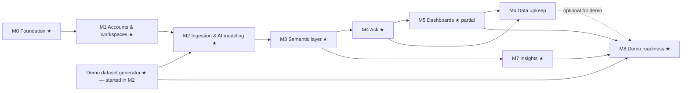

# Master Plan

**Legend:**

- `[ ]` todo, `[x]` done
- **★** marks the **demo-critical path**, the minimum needed for the investor demo
- Items marked **(cuttable)** can move after the demo if time is short

**Rules:**

- **Zero-cost rule (ADR-026):** free options only until production and revenue. The one exception is
  capped AI API spend (ADR-027). Anything that would cost money is raised with the owner first.
- Work milestone by milestone.
- A milestone is done only when its acceptance criteria pass **and** the owner confirms.
- Update the checkboxes at the end of every session.

## Milestone overview and dependencies

**Demo-critical path:** M0 → M1 → M2 → M3 → M4 → M5 (auto-dashboard, date filter, pin, chat edit) → M7
→ M8.

**Cuttable for a first demo if the date is tight:**

- M5 drag/resize layout
- M6 chat-based record entry
- M6 structural changes by chat (Journey 6)

Re-upload/merge (M6) is *not* cuttable for the product, but is optional for the first demo.

---

## M0 — Foundation ★

**Goal:** a runnable, well-tooled empty monorepo, with CI, local Postgres, and all planning docs.

**Docs:**

- [x] Planning docs created:
  - CLAUDE.md
  - PLAN
  - PROGRESS
  - ARCHITECTURE
  - DECISIONS
  - PRODUCT_SPEC
  - AI_DESIGN
  - VERTICAL_PACKS
  - DEMO_SCRIPT
  - OPEN_QUESTIONS
- [x] Owner approval of the plan; all proposed defaults accepted, plus the zero-cost rule (2026-10-13)

**Repo and tooling:**

- [x] pnpm workspace with these packages:
  - `apps/web`
  - `apps/worker`
  - `packages/{platform,db,core,ingest,ai,packs}` (`platform` added for env and logging)
  - `evals/`
  - `scripts/`
- [x] TypeScript strict base config, shared tsconfig (TypeScript 6.0; see ADR-028)
- [x] ESLint 10 (type-aware typescript-eslint, Next plugin, `no-restricted-imports` enforcing package
  boundaries). Import-order linting is deferred: not worth a plugin yet.
- [x] Prettier
- [x] Node 24 LTS pinned (`.nvmrc`; `engines` ≥ 22.12); pnpm pinned via `packageManager`
- [x] Next.js 16 app scaffold (App Router), Tailwind 4, shadcn/ui (components.json, tokens, Button), base
  layout, `/api/health`
- [x] Worker scaffold with pg-boss and graceful shutdown; `system.noop` job; `enqueue:noop` helper
- [x] Job framework (`@bizr/core/jobs`):
  - resumable, checkpointed steps (`app.job_run`, ADR-029)
  - `JOB_RUNNER=worker|inline`
  - `GET|POST /api/jobs/drain` (bearer secret, step time budget, `?maintenance=1`)
  - integration tests run the multi-step noop job in both modes, including yielding, resuming and
    failure
- [x] `docker-compose.yml`: Postgres 17 plus a test database. Roles are created by an idempotent
  `pnpm db:setup` (same command in CI) instead of an init script, so passwords come from `.env`.
- [x] Env config module with Zod validation (`getEnv()`); `.env.example` lists every variable
- [x] Drizzle setup in `packages/db`: migration tooling; initial migration creates `app` and `app.job_run`;
  migrate script grants control-plane privileges
- [x] Vitest across packages (unit + `*.int.test.ts` integration); Playwright smoke tests (desktop +
  mobile)
- [x] GitHub Actions CI (cancels superseded runs, caches pnpm, never calls the AI API):
  - install
  - format check
  - lint
  - typecheck
  - pack validation
  - unit + integration tests against a Postgres 17 service container
  - e2e smoke job
- [x] `pnpm` scripts as listed in CLAUDE.md (the ones that exist so far)
- [x] README with quick start
- [x] Logging: pino with correlation ids via AsyncLocalStorage (`withLogContext`)
- [x] CI green on GitHub (run #1, 2026-10-13: both jobs passed in ~2.5 min)

**Acceptance:**

- `docker compose up -d && pnpm install && pnpm db:setup && pnpm db:migrate && pnpm dev` serves a page.
- `pnpm dev:worker` connects to the queue.
- CI is green on a PR to `main`.
- A fresh clone can follow the README with no undocumented steps.

---

## M1 — Accounts and workspaces ★

**Goal:** users can sign up, create a workspace with industry and locale settings, and get an isolated
tenant schema.

**Depends on:** M0.

- [x] Better Auth: email/password + Google OAuth; sessions; password reset. Email goes to the server
  log locally; a Resend (free tier) sender is used when `RESEND_API_KEY` is set. Google is built but
  switched off until the owner creates the free OAuth client (`docs/RUNBOOK_GOOGLE_OAUTH.md`).
- [x] Control-plane tables:
  - `workspace`
  - `workspace_member`
  - `workspace_settings`
  - `audit_event`
  - `query_run`
  - Better Auth `user`/`session`/`account`/`verification`
- [x] Onboarding screen: business name, industry picker (retail pack + "coming soon" options), currency,
  date order (live example), time zone, with locale-based guesses
- [x] Tenant provisioning service (`@bizr/core/tenancy`, moved from `packages/db` so it can use the
  identifier helper), run as `bizr_admin`:
  - creates schemas `t_<id>` and `t_<id>_snap`
  - creates the roles `t_<id>_reader` and `t_<id>_writer`
  - sets up grants and default privileges
  - grants role membership to `bizr_tenant`
  - idempotent
- [x] Tenant deprovisioning (workspace delete) with typed confirmation (owner only)
- [x] Safe executor (`@bizr/core/executor`):
  - transaction, pinned `search_path` + timeouts, then `SET LOCAL ROLE`
  - READ ONLY cursor with a row cap
  - `query_run` logging
  - user-safe errors
- [x] **Isolation integration tests** (17 cases), including:
  - cross-tenant reads, even schema-qualified
  - snapshot schema and control plane unreachable
  - the reader can't write; the writer can't delete or change structure
  - `bizr_app` and the bare broker can't read tenants
  - `set_config` role switching blocked
  - timeout, row cap and parameters
- [x] App shell:
  - sidebar (desktop) and bottom tabs (mobile)
  - placeholder pages for Home / Ask / Dashboard / My data / More
  - Settings page (edit details, delete business)
  - every page and action resolves the workspace from session + membership (`requireWorkspace`)
- [x] Members model (invite UI deferred; data model and owner/member roles in place)
- [x] Pack loader (`packages/packs`):
  - Zod schemas for manifest + entities, with cross-reference checks
  - full `retail` entity catalog (13 entities, 86 fields)
  - packs compiled to a generated module (`pnpm packs:build`); `pnpm packs:validate` fails if stale
- [x] E2E journeys (desktop + mobile):
  - sign up → onboarding → shell → settings
  - sign out → sign in
  - delete
  - duplicate email and wrong password messages
  - non-member gets 404
  - signed-out redirect

**Acceptance:**

- A new user can sign up (email ✅; Google once the owner adds the OAuth client), create a workspace, and
  see the app shell on desktop and mobile.
- A tenant schema and roles exist for the workspace.
- The isolation test suite passes in CI.
- No tenant access path exists through `bizr_app`.

---

## M2 — Ingestion and AI data modeling ★

**Goal:** messy files → AI proposal → plain-language review → approved → clean tenant tables + data quality
report.

**Depends on:** M1. The demo dataset generator starts here because it doubles as the main fixture.

**Demo data:**

- [x] ★ `packages/demo-data` (ADR-036): a seeded generator for the **Fernwood Home & Gift** dataset (see
  DEMO_SCRIPT §3). Has a `--today` anchor so stories are always current. Outputs messy xlsx/csv plus a
  clean ground-truth JSON.

**Parsing and profiling:**

- [x] Storage interface with `local`, `postgres` (`app.storage_blob`) and `s3` drivers (the s3 driver is
  tested against MinIO in Docker; no cloud account needed); upload route with size/type checks; sha256.
  *Done: local + postgres, content-addressed. S3 deferred to the production upgrade (ADR-036).*
- [x] Parsing: ExcelJS (xlsx; ADR-032), Papa Parse (csv), encoding detection; merged-cell expansion; Excel
  serial dates
- [x] Region detector: header rows, multi-row headers, title rows, section rows, totals, blank and note rows,
  multiple tables per sheet. Unit-tested on fixtures.
- [x] Column profiler: type candidates with ratios, date-format candidates with date-order resolution,
  number locale detection, units, currency symbols, null sentinels, distinct/top values, pattern
  signatures, near-duplicate clusters
- [x] PII masking of samples (ADR-020)

**Cleaning and AI:**

- [x] Cleaning-rule engine (`packages/ingest/cleaning`), covering all rules in AI_DESIGN §3.3, **test-first**
- [x] Retail pack: full `entities.yaml`, `synonyms.yaml`, `patterns.yaml` (incl. known export formats),
  domain primer
- [x] AI layer (all but the model comparison, which needs the API key, Q20):
  - provider interface
  - Anthropic implementation (structured outputs, caching, refusal handling)
  - `ai_call` logging with cost
  - prompt versioning
  - replay mode (record/replay); tests and CI replay only, with a miss treated as a failure
  - spend guard (`AI_BUDGET_DAILY_USD` / `AI_BUDGET_MONTHLY_USD`) with deterministic fallbacks (ADR-027)
  - Sonnet-vs-Opus comparison for data modeling on the ingest eval, to pick the cheapest tier that meets
    the bar
- [x] Task A `proposeDataModel`, Task B `reviseDataModel`, Task C `summarizeProposal`, behind a
  rule-based proposer (ADR-033). *Tested with fake providers; first live run waits for the key (Q20).*
- [x] Proposal validator + dry-run executor (stats per entity, issues per row)

**Change plans and loading:**

- [x] ★ Change-plan schema + compiler (create_entity, add_field, add_relationship, create_index),
  **test-first**, with golden DDL snapshots
- [x] Migration recorder (`app.migration`) + catalog writer (`app.entity/field/relationship`)
- [x] Loader (ADR-035):
  - batch parameterised INSERT into tenant tables (instead of COPY)
  - lineage and system columns
  - natural keys and row hashes
  - reference resolution with an `<entity>_ref` fallback
  - `row_issue` + `quality_report`

**Jobs and UI:**

- [x] Jobs: `ingest.analyze` (was `ingest.parse`), `ingest.revise`, `ingest.apply`, written as checkpointed steps (each within
  `JOB_STEP_BUDGET_MS`), with progress reporting and idempotency; verified in both runner modes
- [x] UI:
  - upload screen
  - processing screen (stages + teaser)
  - **"Here's what we found" review screen** (summary, questions, record-type cards, mapping edit menu,
    skip list, assumptions, correction chat)
  - setting-up screen
  - data quality report

**Evals:**

- [x] Eval harness skeleton + `evals/fixtures/ingest` (≥ 10 cases at M2, ≥ 15 by M8) + injection canaries
  *(11 cases; rules-only suite runs in CI)*

**Acceptance:**

- The demo dataset goes from upload to loaded data with a correct quality report. Every entity count
  matches the generator's ground truth.
- ≤ 3 user questions. ≤ 2 minutes of user time.
- Ingest eval:
  - ≥ 90% field mapping F1
  - ≥ 95% totals/blank row detection
  - 0 injection canary failures
- Cleaning-rule and compiler unit tests ≥ 90% line coverage.
- Re-running `ingest.apply` is idempotent.

**Acceptance status (2026-10-15):** met for the rule-based path.

- Demo dataset: every count matches the answer key (integration + e2e tests).
- 3 questions; upload to report takes about 15 seconds of machine time in the e2e test.
- Ingest eval (rules): field-mapping F1 1.0, totals/notes/blank detection 100% on the cases, 0 canary
  failures.
- Cleaning and compiler line coverage: 96%.
- Re-running `ingest.apply` is tested.
- **Still open:** the live AI eval and the Sonnet-vs-Opus comparison (Q20).

---

## M3 — Semantic layer ★

**Goal:** each workspace has a complete business catalog: entities, fields, relationships and metrics
(with availability), viewable in plain language.

**Depends on:** M2.

- [x] Metric IR schema + compiler (aggregation, safe divide, filters, refs, time bucketing in the workspace
  timezone, comparison periods, fan-out-safe aggregation across joins)
- [x] Join-path resolver over the relationship graph (preferred paths from the pack; ambiguity → error)
- [x] Retail pack `metrics.yaml` (all metrics in VERTICAL_PACKS §2.5), with pack-level compile tests
- [x] Metric availability computation + plain-language unavailable reasons + "unlock" hints
- [x] System views per workspace (e.g. `v_sale_lines_enriched`), regenerated after structural changes
- [x] Query-spec schema + compiler (`QuerySpec` → SQL), **test-first**, with golden SQL snapshots and
  result tests against the demo dataset
- [x] "What we track" glossary page: measures with definitions, record types and their details, links
  ("Sales are linked to customers")
- [x] Rename display names (metadata only) from the glossary

**Acceptance:**

- Every retail metric compiles and returns values on the demo dataset that match hand-computed ground
  truth, across:
  - date ranges
  - channel and category breakdowns
  - comparison periods
- Unavailable metrics show the correct reason when costs or stock are removed from the fixture.

**Acceptance status (2026-10-16):** met.

- All 28 retail metrics run on the demo data loaded the normal way and match values computed from the
  simulated business (`semantic.int.test.ts`):
  - a month
  - channel, category and monthly breakdowns
  - a previous-period comparison
  - stock, customer and money-owed snapshots
- Removing costs or stock gives the pack's plain-language reason. Removing returns makes net sales
  equal sales after discounts.
- Known data limit: till items written differently from the stock list ("Sage Mug") don't link to a
  product, so product-level numbers there wait for M5's matching fixes (R20).

---

## M4 — Ask ★

**Goal:** plain-language questions → correct, explained answers with charts. Safe by construction.

**Depends on:** M3.

- [x] Task D `interpretQuestion` (spec / clarify / sql / unanswerable), with the ambiguity policy
- [x] SQL validator (`libpg-query`) per AI_DESIGN §6, **test-first**, plus an adversarial suite of
  ≥ 150 cases
- [x] Fact extraction (deterministic) + Task E `narrateAnswer` with placeholder validation + template
  fallback
- [x] Task F `explainSql` (fallback path only)
- [x] Deterministic chart chooser + Recharts components (kpi, line, bar, bar_horizontal, stacked_bar,
  table); accessible table alternative
- [x] "How I calculated this" generator (deterministic from spec) + Details (SQL, records scanned)
- [x] Ask UI: empty state with chips, thinking state, answer card, clarify card, unanswerable card,
  follow-ups (conversation context), 👍/👎 feedback
- [x] Pin to dashboard (needs the M5 tile model; implement the tile storage here if M5 hasn't started)
- [x] Question eval set (≥ 150 cases) + demo-script subset

**Acceptance:**

- Question eval:
  - ≥ 85% execution accuracy overall
  - ≥ 95% on the demo-script subset
  - clarification precision ≥ 80%
- SQL validator adversarial suite: 100% rejected or harmless.
- 0 narrative numbers not sourced from facts.
- Ask p95 latency ≤ 6s on the demo dataset.

---

## M5 — Dashboards ★ (partial ★)

**Goal:** an auto-generated industry dashboard on day one, editable by chat and by hand, with a global
date filter.

**Depends on:** M4 (shares spec compiler, charts, pin).

- [x] ★ Dashboard/tile/version tables; tile = spec + chart + layout
- [x] ★ Default dashboard generation from pack `dashboard.yaml`, skipping unavailable tiles + "Unlock more"
  card
- [x] ★ Dashboard page with responsive grid (react-grid-layout), tile states, per-tile caching keyed by
  data version
- [x] ★ Global date range picker + compare toggle; fixed-date tile badge
- [x] ★ Task G `planDashboardEdit` + preview/apply/undo
- [x] Drag/resize layout editing (desktop); reorder on mobile **(cuttable)**: done from the tile
  menu (wider/narrower, move to top/bottom) rather than drag and drop (ADR-042)
- [x] Tile ⋮ menu: rename, change chart, remove, "Ask about this"
- [x] Dashboard edit eval set (≥ 40 cases)

**Acceptance:**

- A new demo workspace lands on a correct dashboard.
- "Add a chart of sales by city" / "remove X" / "show monthly" work via chat with preview and undo.
- The date filter updates all tiles.
- Dashboard edit eval ≥ 90%.

---

## M6 — Data upkeep

**Goal:** keep data current safely: re-upload with merge preview, a records browser with edits, adding
records by chat, structural changes by chat with versioning and rollback.

**Depends on:** M4, M5.

**Re-upload:**

- [x] Data-source fingerprinting + match confirmation
- [x] Merge/diff engine (`packages/core/merge`), **test-first**:
  - new / changed / unchanged / missing / conflicts
  - never auto-delete
  - `record_edit` for undo
- [x] Re-upload UI: change preview, conflict resolution, apply, undo

**Records:**

- [x] Records browser: virtualised grid (TanStack Table), filters, sort, search, inline type-aware edit,
  record side panel with lineage and history, soft delete + "Recently deleted"
- [x] Mobile card list for records
- [x] Task H `planRecordWrite` + confirmation card + writer-role execution + undo **(cuttable for the
  first demo)**

**Structural changes:**

- [x] Change-plan compiler: remaining ops (change_field_type, remove_field, remove_entity,
  remove_relationship, add_allowed_values, metrics); impact analysis; inverse plans; lossy-rollback
  detection
- [x] Snapshots (ADR-023) + `snapshot.gc` job
- [x] Task I `planChange` + change plan card + typed confirmation for destructive changes **(cuttable for
  the first demo)**
- [x] Change history page with undo

**Members:**

- [x] Member invites (email link), member role enforcement

**Evals:**

- [x] Eval sets: record writes (≥ 40), change plans (≥ 30)

**Acceptance:**

- Re-uploading the demo "next month" file shows the correct diff, merges without data loss, and can be
  undone.
- No code path deletes rows that are missing from a new file.
- Every structural change is versioned and rollback works, verified by an integration test for each op.
- Destructive changes always snapshot first.

---

## M7 — Insights ★

**Goal:** proactive, correct, plain-language insights after every data change, plus a weekly digest.

**Depends on:** M3. It can run in parallel with M4–M5 once M3 is done.

- [x] Insight rule engine: compile pack rules (spec or trusted templates with placeholders), execute,
  facts, severity, fingerprint/cooldown/dismissal
- [x] Retail pack `insights.yaml`: all rules in VERTICAL_PACKS §2.7, with thresholds
- [x] Task J `phraseInsights` (optional phrasing) with placeholder validation
- [x] Triggers: after apply/merge/record writes (debounced), daily cron
- [x] Home screen: KPI strip, insight feed (top 5), "Ask anything" box, empty/not-enough-history states
- [x] All insights page; dismiss / not useful; alert settings page (toggles + thresholds)
- [x] Weekly digest card (in-app)
- [x] Insight correctness tests against the generator's planted stories

**Acceptance:**

- On the demo dataset, all planted stories are detected with correct numbers (verified against ground
  truth):
  - stock-out risk
  - declining customer
  - dead stock
  - margin squeeze
  - return spike
  - channel shift
  - overdue payments
- There are no false "urgent" alerts on the control fixture.

---

## M8 — Demo readiness ★

**Goal:** a reliable, polished, rehearsed 5–7 minute investor demo.

**Depends on:** M5, M7 (M6 optional).

**Demo data and resilience:**

- [x] Demo dataset finalised. Includes a "next month" update file for the re-upload scene (if M6 is done).
- [x] One-click "Try the demo shop" (create/reset demo workspace, pre-imported or live import)
- [x] AI replay recordings for the demo path; verify a full demo run with the network to Anthropic blocked
  (the demo path needs no AI at all; recordings get made once the key arrives, Q20)
- [x] "Fresh upload" demo variant: live import of the messy files, using recordings as a safety net

**Performance and polish:**

- [x] Performance pass:
  - Home LCP ≤ 2s
  - Ask p95 ≤ 6s
  - tiles ≤ 1.5s p95
  - indexes reviewed
  - spec result caching
- [x] Polish pass:
  - copy linter for banned jargon
  - empty/error states
  - mobile QA (iPhone SE size and up)
  - accessibility check
  - loading skeletons
  - favicon/brand placeholder

**Internal tools and docs:**

- [x] Internal admin page: AI cost per workspace, latency percentiles, validation-failure rates, eval
  baselines
- [x] Local "demo machine" setup: one command (`pnpm demo:up`) starts Postgres, web and worker, resets the
  demo workspace, and switches AI to replay mode
- [ ] *(Optional, $0)* Stage 1 free hosted preview: Vercel Hobby (or equivalent) + Neon Free + inline
  jobs + Postgres storage + daily cron. Re-verify free-tier limits and terms first (OPEN_QUESTIONS Q19).
  Ready apart from the accounts (2026-10-26): `apps/web/vercel.json`, `pnpm preview:check`,
  `docs/RUNBOOK_PREVIEW.md`, managed-Postgres setup (ADR-054). Account creation and terms are the
  owner's (Q19).
- [x] Production upgrade runbook written (`docs/RUNBOOK_PRODUCTION.md`): the Stage 2 switch (paid web
  plan, dedicated worker, R2, Sentry, custom domain). **Not executed until revenue.**
- [ ] DEMO_SCRIPT rehearsal checklist completed twice end to end, with timings recorded (automated
  twice: 38.5 s and 33.1 s of machine time; the two presenter runs are the owner's, Q24)
- [x] Full eval run; results recorded in PROGRESS

**Acceptance:**

- Two consecutive full rehearsals finish within 7 minutes with zero errors.
- The demo works with the network to the AI provider blocked (replay).
- Infrastructure spend to date: $0. AI spend within the agreed budget (reported from `app.ai_call`).
- All milestone acceptance criteria still hold.

---

## M9 — Ready for a first real customer ($0)

**Goal:** what a first paying shop needs beyond the demo, still at no cost. The owner asked on
2026-10-26 to keep building while the M8 owner items (preview accounts, presenter rehearsals) wait.

**Depends on:** M8.

- [x] Per-business database logins (ADR-055): own login per business, derived passwords, backfill
  and rotation command, isolation tests in both modes, CI with logins on
- [x] Download any answer or dashboard tile as a spreadsheet (CSV / Excel), and "Download all my
  data" (every record type as a sheet) (ADR-056)
- [x] Email the weekly summary and new urgent alerts (Resend free tier; off without a key), with
  per-person settings and one-click unsubscribe (ADR-057)

**Acceptance:**

- With `TENANT_LOGIN_SECRET` set, no statement run for one business can reach another business's
  data, on a database without a superuser too (tested).
- Every answer, tile and record type can be downloaded, with the numbers exactly as shown in the app
  and plain-language column names.
- Emails contain only what the app already shows that person, link back to the app, and stop with one
  click. Nothing is sent without an email key.
- All earlier acceptance criteria still hold; CI green; $0 spend.

---

## M10 — Connected sources ($0)

**Goal:** owners stop re-uploading files by hand. A shop links a Google Sheet or its Shopify store once.
After that, BizRetriever brings in changes by itself and asks only when a person is needed. The owner
said on 2026-10-26 to keep going after M9; connectors are the roadmap's first row.

**Depends on:** M6 (re-upload and merge) and M9.

- [x] Connections: a linked source per business, a sync job (fetch, skip if unchanged, import through
  the normal pipeline), automatic update when nothing needs a person, otherwise a "needs a look"
  notice. Daily sync, "Update now", pause and unlink.
- [x] Google Sheets by share link (no account or key): safe fetching (fixed Google hosts only, size
  limit, clear messages for private or deleted sheets)
- [x] Shopify: connect a store through Shopify's sign-in (a Dev Dashboard app, free), with the access
  token encrypted at rest. Products, stock, customers and orders come in as tables through the same
  pipeline; webhooks for uninstall and privacy requests. Off without app keys. (Live check on a
  development store: owner, Q26.)
- [x] UI: "Link a Google Sheet" and "Connect Shopify" on the import page; linked sources on My data
  with their last update and status
- [x] Tests (fixtures only, no network), e2e, docs, runbook for creating the Shopify app

**Acceptance:**

- A linked sheet that changes is brought in automatically when every sheet is recognised and nothing
  conflicts with the owner's own edits; otherwise the owner is asked, exactly as for a re-upload.
  Unchanged sources do nothing.
- Nothing is ever fetched from an address a user typed: only from Google's and the shop's own
  Shopify addresses, built by our code.
- Shopify tokens are encrypted; uninstalling the app or a privacy request is honoured. Without app
  keys, the Shopify option is hidden.
- All earlier acceptance criteria still hold; CI green; $0 spend.

---

## M11 — Planning ahead ($0)

**Goal:** answer "what's coming?" as well as "what happened?". The owner sees an honest estimate of
the next weeks' sales that knows the usual season, sets a monthly goal and sees whether they're on
pace, and gets one list of what to reorder and how much. The owner said "keep going" on 2026-10-26
after M10; forecasting and goals are the next roadmap rows that need no accounts.

**Depends on:** M3 (metrics), M7 (insights), M9 (downloads, emails).

- [x] Forecast engine (pure, test-first): daily history → daily estimates from the business's own
  year (month-of-year and weekday patterns, current level from recent weeks), with a range from how
  wrong the same method was on past weeks; plain fallback with less than a year of history. Every
  estimate says what it assumed.
- [x] Demo data: an option for two years of history, and a back-test on it (forecast November from 1
  November using only earlier data, compare with what was sold)
- [x] Goals: a monthly goal per business for a pack measure (net sales, orders, gross profit); Home
  shows progress and where the month is heading; the weekly email says it too
- [x] Reorder list: every product that needs ordering, with a quantity that covers the supplier's
  lead time plus 30 days including the usual season, grouped by supplier, downloadable
- [x] Pack settings for which measures can have goals and estimates; copy, e2e, docs

**Acceptance:**

- On the two-year demo shop, the November sales estimate made on 1 November is within 15% of what
  was sold, and closer than the plain run-rate. A shop with three months of history gets a plain
  estimate that says it doesn't know the season yet.
- Estimates are always labelled as estimates, with a range and what they assumed. They are computed
  by code from executed queries, never by the AI.
- Goal progress and projections match the numbers the app shows elsewhere for the same dates.
- All earlier acceptance criteria still hold; CI green; $0 spend.

---

## M12 — Asking about what's ahead ($0)

**Goal:** owners can ask about the future the way they ask about the past. "How much will I sell next
month?", "Am I on track for my goal?" and "What should I reorder?" get an answer in Ask from the M11
planning engine. The reorder list also knows each product's own season, so Christmas stock is
suggested in October even though it isn't selling yet. The owner said "let's continue" on 2026-10-26
after M11.

**Depends on:** M4 (Ask), M11.

- [x] Ask: forward-looking questions recognised by rules before interpretation (the AI's answer
  schema is unchanged): estimates for a planning measure and period (next week, next month, the
  next N days or weeks, a named coming month, the rest of this month), goal progress, and what to
  reorder. Answers in the Ask card, with "how I worked it out" and assumptions; downloadable; never
  pinned as a dashboard tile (an estimate isn't a record)
- [x] A clear answer for measures that can't be estimated ("I can estimate sales, orders and items
  sold")
- [x] Reorder list: each product's own season from last year's same weeks, so seasonal products
  that aren't selling now appear before their season
- [x] Question eval: forward-looking questions added and scored; pack example questions
- [x] Tests, e2e, docs

**Acceptance:**

- The forward-looking questions in the eval are recognised (≥ 90%), and none of the existing
  historical questions are taken for estimates.
- On the demo shop with two years of trading, a reorder list made in mid-October includes the
  Christmas products, with quantities in line with what they sold the year before.
- Estimate answers show their range and assumptions, and every number comes from the engine or an
  executed query, never from the AI.
- All earlier acceptance criteria still hold; CI green; $0 spend.

---

## M13 — Working as a team ($0)

**Goal:** a business with more than one person can share the work safely. The owner can add someone
who can look but not change anything (a bookkeeper, an investor, a part-time helper). People can
leave a note on an insight or an answer ("ordered 50 more, arriving Friday") and hand an insight to
someone to deal with, who then sees it on their Home and in their weekly email. The owner said
"continue" on 2026-10-27 after M12; this is the roadmap's collaboration row, and it needs no
accounts.

**Depends on:** M4 (saved answers), M6 (invites and roles), M7 (insights), M9 (emails).

- [x] A "can view" role next to owner and member: sees everything, asks questions, downloads, leaves
  notes; cannot bring in files, change records or the set-up, link sources, approve imports, edit
  the dashboard, set goals or alerts. Enforced in the core services, not only hidden in the UI;
  a test lists every server action and changing route and fails if one isn't either guarded or
  explicitly allowed for viewers
- [x] The owner picks the role when inviting and can change a person's role later; settings show
  what each role can do in plain words
- [x] Notes on insights and on saved answers: short plain text with who and when; the author or the
  owner can delete one; shown only inside the business; recorded in the activity log
- [x] Hand an insight to a person: "For you" on their Home, a line in their weekly email, and the
  insight shows who has it; marking it done clears it
- [x] Tests (role matrix, isolation of notes between businesses), e2e, copy, docs

**Acceptance:**

- A viewer can open every page and ask questions, but every attempt to change something (server
  actions and routes, called directly) is refused, and the UI doesn't offer it.
- Notes and assignments never show outside their business, are plain text only, and their numbers
  are never shown as facts.
- An insight handed to someone appears on their Home and in their next weekly email, and not on
  anyone else's "For you".
- All earlier acceptance criteria still hold; CI green; $0 spend.

---

## M14 — A second industry: Wholesale & distribution ($0)

**Goal:** businesses that sell to other businesses (distributors, importers, makers selling to
stockists, cafés and salons) get the same outcome from their messy files, in their own terms: who
owes them money and how late, accounts over their credit limit, accounts that stopped reordering,
margin per account and backorders. It is also the test of the pack promise: the core reads its
industry choices from the pack, and a new pack needs no new core code. The owner said "continue" on
2026-10-27 after M13; a second vertical is the first candidate listed then.

**Depends on:** M2–M7 (import, measures, Ask, dashboard, insights), M11 (planning).

- [x] The core reads industry choices from the pack, not code: Home's and the weekly summary's key
  numbers, the reorder list's measures, the goal words in Ask. Retail behaves exactly as before
- [x] Import without AI for any pack: a sheet whose columns mostly match one kind of record (a
  customer list with credit limits, a payments sheet) is recognised from the pack's own words, and
  extra columns that match details of a recognised record are kept
- [x] The `wholesale` pack: trade accounts (terms, credit limit, sales rep), invoices with due dates,
  payments, backorders, products, stock and suppliers; synonyms and known export formats; measures
  (owed, overdue, days to get paid, credit used, revenue and margin per account, backorders);
  dashboard; insights (over the credit limit, paying later than usual, an account that missed its
  usual reorder, margin squeeze per account, backorders building, stock running out); example
  questions; planning measures
- [x] Demo wholesale business with messy files and planted stories (ground truth); ingest fixtures;
  question and dashboard evals for the pack
- [x] Onboarding offers "I sell to other businesses"; pack docs (VERTICAL_PACKS Part 3); tests, e2e

**Acceptance:**

- The demo wholesale business's files are brought in without AI, every planted story is found by
  the insights, and the numbers match the ground truth.
- The wholesale question eval scores at least 85% with rules only; the retail evals are unchanged.
- Adding the pack needed only the pack files and its registration; every core change is
  industry-neutral and keeps retail's results identical.
- All earlier acceptance criteria still hold; CI green; $0 spend.

---

## Build order after M14 (owner, 2026-10-27)

The owner confirmed M14 and asked for everything left that needs no outside account or key to be
built, without the AI key ("we will test once we are done completely"). Each milestone below is
planned here when it starts and checked without AI. Items that need an account (billing, WhatsApp,
hosting, Sentry) wait with the other owner items.

1. M15 — Reports: PDF answers and dashboards, scheduled report emails
2. M16 — Platform: public API, MCP server, webhooks
3. M17 — Production storage: S3/R2 driver and moving files to it
4. M18 — More connectors (built and tested on recorded answers, hidden until keys): QuickBooks,
   Xero, Square, WooCommerce
5. M19 — Team extras: transfer ownership, @mentions in notes
6. M20 — Multi-currency and a second language

---

## M15 — Reports you can send ($0)

**Goal:** an answer or the whole dashboard can be saved as a tidy PDF to print or send to an
accountant, and an owner can have the dashboard or a saved question emailed to them every week or
month, worked out fresh each time.

**Depends on:** M4 (answers), M5 (dashboard), M9 (downloads, emails).

- [x] PDF writer (free library, no service): title, business, dates, the answer's sentence, a simple
  chart drawn by code, the table, how it was worked out, assumptions, page numbers; every number is
  the executed query's, formatted as the app shows it
- [x] "Download as PDF" for answers, dashboard tiles and the whole dashboard
- [x] Scheduled reports: "Email me this every Monday / on the 1st" for the dashboard and for a
  question; run fresh by the daily job, sent once per period, with an unsubscribe link; anyone in
  the business (viewers too) can schedule reports for themselves
- [x] Settings list of my reports (pause, delete); tests, e2e, docs

**Acceptance:**

- A PDF of an answer holds the same numbers as its Excel download, and the dashboard PDF every tile
  that works on screen.
- A weekly report is sent once a week however often the job runs, re-runs the question with that
  day's data, and stops when unsubscribed or deleted.
- All earlier acceptance criteria still hold; CI green; $0 spend.

---

## Roadmap (later — documented, not built now)

| Area | Item |
|---|---|
| Connectors | Square/Lightspeed/Clover POS, WooCommerce, Amazon Seller Central, Etsy API, QuickBooks/Xero |
| Channels | WhatsApp questions and alerts (email digests and alerts: done in M9) |
| Product | Multilingual UI and questions; multi-currency; estimates handed over by the AI (rules-only now) (season-aware estimates, goals and the reorder list: M11; in Ask and per-product seasons: M12); scheduled reports and PDF export: M15 (CSV/Excel: M9) |
| Collaboration | Granular per-area permissions; ownership transfer; @mentions (view-only role, notes and handing insights to people: M13) |
| Platform | Public API and MCP server exposing the semantic layer to other apps and agents; webhooks |
| Packs | Restaurants/food service, services/agencies, health & beauty salons (wholesale/distribution: M14) |
| Business | Billing and plans (usage-based AI cost informs pricing); onboarding concierge |
| Production upgrade (after revenue) | Execute the Stage 2 runbook: paid web plan, dedicated worker (`JOB_RUNNER=worker`), S3/R2 storage + migration of blobs, Sentry, custom domain, backups/PITR |
| Hardening | Tenant sharding across databases; SOC 2 readiness; data residency (EU) |
